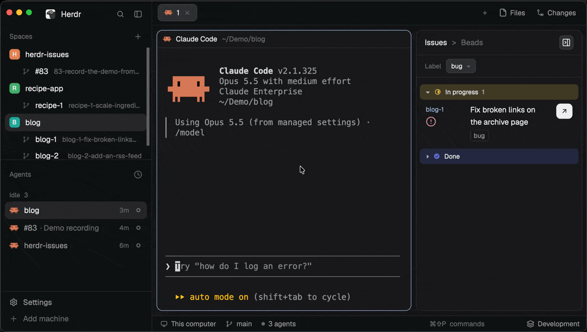

# Herdr Issues



## What it is

An Issues panel for the Herdr desktop app, and a Claude Code plugin that works the same issues from Claude sessions.

- **Your issues beside your terminals.** The Herdr mod's Issues panel lists the issues of the repository in the focused pane, from Linear, GitHub Issues or a local Beads database, and lets you read and edit them in place.
- **One click to start.** **Start** opens an issue's branch in its own worktree and Herdr space, with Claude already working the issue.
- **Claude knows what you're looking at.** Claude sessions in Herdr know which issues the panel lists and which one is open, so "the issues" and "this issue" mean what you see.
- **Skills for the whole loop.** The Claude Code plugin's `issues:*` skills create, plan, triage and work issues in whichever tracker the repository uses.

## Quickstart

Install with one command:

```sh
curl -fsSL https://raw.githubusercontent.com/kevinthompson/herdr-issues/main/bootstrap | bash
```

Run the same command again to update.

Start a new Claude Code session to load the plugin, then press **Cmd-Shift-I** in Herdr to collapse the Issues panel to a thin strip or expand it again; the strip's button expands it too. With the panel focused, **Cmd-R** refreshes its list.

## Getting started

You need:

- [Herdr](https://herdr.dev/), opened at least once
- [Claude Code](https://claude.com/product/claude-code), only for the `issues:*` skills and the Claude hooks; the panel works without it
- `git`
- Node.js 22.15 or later
- the [GitHub CLI](https://cli.github.com) (`gh`), for repositories tracked in GitHub Issues
- the Linear MCP server in Claude Code, for repositories tracked in Linear
- [Beads](https://github.com/steveyegge/beads) (`bd`, `brew install beads`), for repositories tracked locally with Beads

### Linear

The `issues:*` skills reach Linear through Linear's MCP server, so add it to Claude Code once for every project:

```sh
claude mcp add --transport http --scope user linear https://mcp.linear.app/mcp
```

Then start a Claude Code session, run `/mcp`, choose `linear` and sign in to Linear in the browser window it opens. If Linear is connected to your Claude account at claude.ai instead, its tools are already available and the skills use them.

The panel also needs a personal Linear API key: create one on [Linear's Security & access settings](https://linear.app/settings/account/security), then paste it in the field the panel shows when you choose Linear.

[Installation](docs/installation.md) explains what the install command changes and how to update.

## Configuration

The panel shows a setup view for a repository with no tracker configured: choose **GitHub Issues**, **Linear** or **Beads**, and how work gets into main. For options the panel doesn't offer, run `/issues:config` in a Claude Code session in the repository.

Each tracker needs credentials:

- **Linear**: a personal API key, created on [Linear's Security & access settings](https://linear.app/settings/account/security) and saved from the panel's setup view, and the Linear MCP server in Claude Code.
- **GitHub**: a signed-in GitHub CLI (`gh auth login`).
- **Beads**: none; it needs `bd` installed and a database in the repository's main checkout, which the setup view and `/issues:config` offer to make with `bd init`. The panel lists its issues and edits their status, priority and body, and none of it makes a git commit. Every `issues:*` skill works its issues too.

The Claude sessions that work issues run on your own Claude Code model and effort unless `issues.json`'s `workModel` and `workEffort` set them, at the top level or in a repository's entry.

Settings at the top level of `issues.json` apply to every repository without its own: how work gets into main and when it's complete (`merge` and `complete`), what a finished session does about its worktree (`close`), how issue spaces are named (`spaceName`), and the poll interval and issue sessions' model and effort. `workPrompt` is instructions appended to issue sessions' system prompt; a repository's is added after the top level's rather than replacing it. The gear in the panel's header opens its settings: **Repository** edits the focused repository's entry, and **Global** edits these top-level settings.

[Configuration](docs/configuration.md) covers creating the Linear key and every setting in `issues.json`.

## Removing

Run this command:

```sh
~/.local/share/herdr-issues/uninstall
```

It removes the panel, the `issues` command and the Claude plugin, and asks before removing the panel from your layouts and deleting your settings, Linear API key and cached lists. [Installation](docs/installation.md#removing) lists everything it removes.

## Further reading

- [Installation](docs/installation.md): requirements, what the install command changes, updating, checking the mod loads and removing it.
- [Configuration](docs/configuration.md): choosing a tracker, credentials and the `issues.json` settings.
- [Using the panel](docs/using-the-panel.md): scopes and labels, an issue's detail view, starting work and removing a worktree.
- [Claude skills](docs/skills.md): the `issues:*` skills.
- [Contributing](CONTRIBUTING.md): setting up for development, checking and committing a change, and recording the demo.
- [AGENTS.md](AGENTS.md): how the repository is laid out, how to install it for development, how changes reach the running app and Claude Code, and the checks to run before committing.

## License

[MIT](LICENSE)
