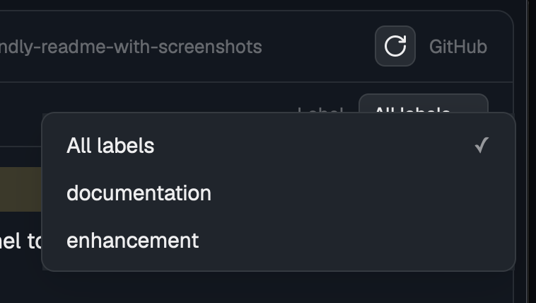
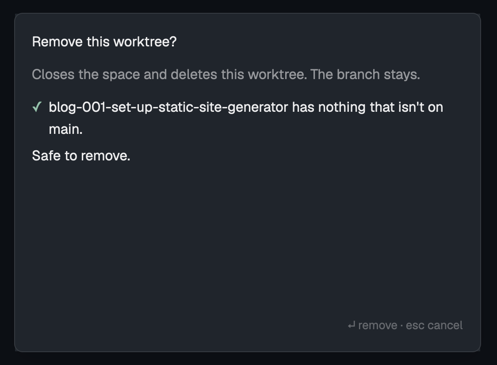

# Herdr Issues

An Issues panel for the Herdr desktop app, and a Claude Code plugin that works the same issues from Claude sessions.


## What it is

**The panel** lists the issues of the repository in the focused pane. Issues can live in either of two trackers, and the panel looks the same for each:

- a Linear team, with its triage queue, projects, milestones and optional saved views;
- GitHub Issues, through the `gh` CLI.

From the panel you can:

- read an issue's status, priority, labels, assignee, delegate, pull requests and description, and edit them;
- start work on an issue in its own worktree, opened as a Herdr space with Claude working the issue;
- remove a finished worktree through a dialog that checks its branch is merged or pushed first.

The panel also tells Claude sessions in Herdr which issues it lists and which issue is open, so "the issues" and "this issue" mean what you see.

**The Claude plugin** adds the `issues:*` skills, which create, plan, triage and work issues in whichever tracker the repository uses.

## Requirements

- Herdr (`herdr-app`), opened at least once so `~/.config/herdr-app/keys.json` exists
- Claude Code (`claude`)
- `jq`
- `git`
- Node.js (`node`) 22.15 or later, for the `issues` command
- the [GitHub CLI](https://cli.github.com) (`gh`), for repositories tracked in GitHub Issues

## Installation

Clone the repository and run its setup script:

```sh
git clone https://github.com/kevinthompson/herdr-issues-mod.git
cd herdr-issues-mod
./setup
```

The script:

- links the checkout to `~/.config/herdr-app/mods/issues`, where Herdr loads it;
- adds the panel's keys to `~/.config/herdr-app/keys.json`, keeping any key you already bound to something else;
- adds the checkout as the `herdr-issues` plugin marketplace and installs the `issues@herdr-issues` plugin;
- offers to add the Issues panel to the side panel of one of your layouts, or of a new copy of Herdr's `main` layout. Herdr's shipped layouts can't be changed, so it never edits them;
- links the `issues` command to `~/.local/bin/issues`, warning if that folder isn't on your `PATH`.

If you skipped the layout step or ran setup without a terminal, run `./setup` again, or follow the steps it printed.

Start a new Claude Code session afterwards to load the plugin. Running `./setup` again is safe; it is also how you update after pulling.

To confirm the mod loads, run:

```sh
herdr-app check ~/.config/herdr-app/mods/issues
```

## Choosing a tracker

Without any setting, the panel looks for a Planning Center repository's Linear team. A repository it can't place shows a setup view in the panel instead: choose **GitHub Issues** or **Linear** (then a team), and the panel checks what that tracker needs and saves the choice. When a configured tracker can't load, the same view says what's wrong and how to fix it, with **Check again** and a way to choose a different tracker.

For saved Linear views, a GitHub repository other than origin's, and the other options the panel doesn't offer, run this in a Claude Code session in the repository:

```
/issues:config
```

It asks which tracker to use, checks the credentials it needs, and saves the choice in `~/.config/herdr-app/issues.json`, where the panel saves its choice too, keyed by the repository's main checkout so its worktrees share it. You can also name the tracker directly: `/issues:config linear <team key>` or `/issues:config github [owner/name]`.

Each tracker needs:

- **Linear**: a personal API key, created in Linear under Settings → Account → Security & access. Save it in `~/.config/herdr-app/linear.json`, readable only by you:

  ```sh
  echo '{ "apiKey": "lin_api_…" }' > ~/.config/herdr-app/linear.json
  chmod 600 ~/.config/herdr-app/linear.json
  ```

  The Claude skills reach Linear through its MCP server, so add the Linear MCP server to Claude Code as well.
- **GitHub**: a signed-in GitHub CLI (`gh auth login`).

An issue's worktree space is named after the issue's ID, such as `#41` or `CAL-2449`. To name a repository's issue spaces differently, add a `spaceName` template to its entry in `issues.json` by hand. It takes two placeholders: `<issueId>`, the issue's ID, and `<repo>`, the repository's name without its owner (the GitHub repository's name for GitHub Issues, else the main checkout's folder name). For example, this names issue #41's space `herdr-issues-mod#41`, which tells it apart from other GitHub repositories' `#41`:

```json
"~/Code/herdr-issues-mod": { "tracker": "github", "spaceName": "<repo><issueId>" }
```

## Using the panel

Press **Cmd-Shift-I** to show or hide the panel. It shows the issues of the repository in the focused pane, grouped by status, and refreshes when issues change.

**Scopes and labels.** When a tracker has more than one list of issues, a dropdown at the top of the panel picks which one it shows. For Linear, the default is every open issue assigned to you; the team's triage queue, its other issues, its saved views and each open project (narrowed to one of its milestones if you like) are the others. The **Label** dropdown narrows the list to issues with one label.



**An issue.** Click an issue to open it in place of the list. Its status and priority are dropdowns, task-list checkboxes in its description check off in place, and **Edit** turns the description into a Markdown editor. **Save** or **Cmd-S** writes it back to the tracker.


**Starting work.** **Start** opens the issue's branch in a new worktree, shown as a Herdr space nested under the repository's space, with a Claude session running `/issues:work` on the issue. **Continue** reopens an issue already in progress, and **Go to space** switches to the space that already shows it. When the work is finished, the Claude session ends with a message saying the worktree can be closed.

**Removing a worktree.** The mod includes a dialog that removes a worktree and closes its space. It shows whether the branch is merged or pushed, and warns about uncommitted changes before anything is lost; the branch itself is kept. Open it from a key or another mod with:

```js
openOverlay({ mod: "issues", kind: "dialog", width: 440, height: 320, props: { space: spaceId, action: "remove" } });
```



## Claude skills

Run these in a Claude Code session in the repository, for example `/issues:work #12`. Each works with the repository's tracker.

| Skill | Use it to |
| --- | --- |
| `/issues:config` | Choose where a repository's issues are tracked (a Linear team or GitHub Issues), and check the credentials that tracker needs. |
| `/issues:create` | Write issues for work that is already settled, as self-contained hand-offs. |
| `/issues:plan` | Turn a prompt, a brief or a full spec into a series of issues by interviewing you. |
| `/issues:triage` | Triage issues, the backlog or Linear's triage queue, making each one small and actionable enough to hand to an agent. |
| `/issues:work` | Work an issue from start to finish, or start several at once, each in its own worktree space. |
| `/issues:delegate` | Hand a Linear issue to Cloud Agent. |

## Contributing

[AGENTS.md](AGENTS.md) describes how the repository is laid out, how to install it for development, how changes reach the running app and Claude Code, and the checks to run before committing.
