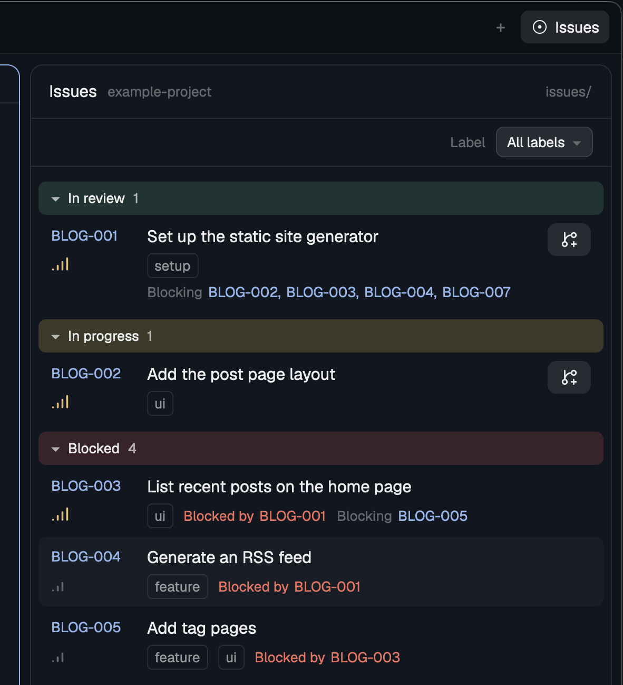
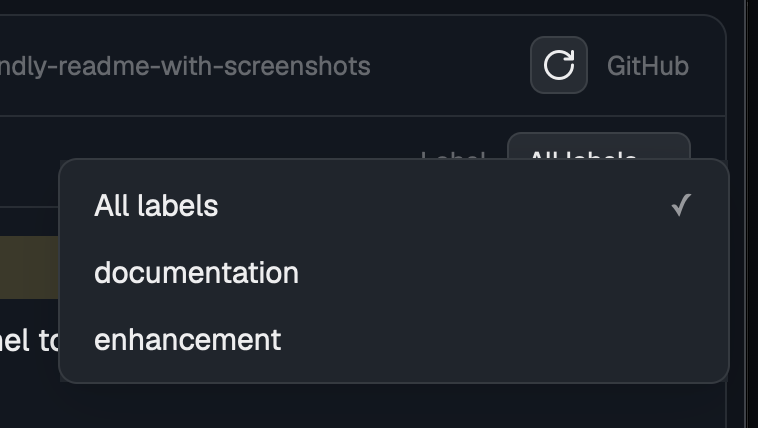
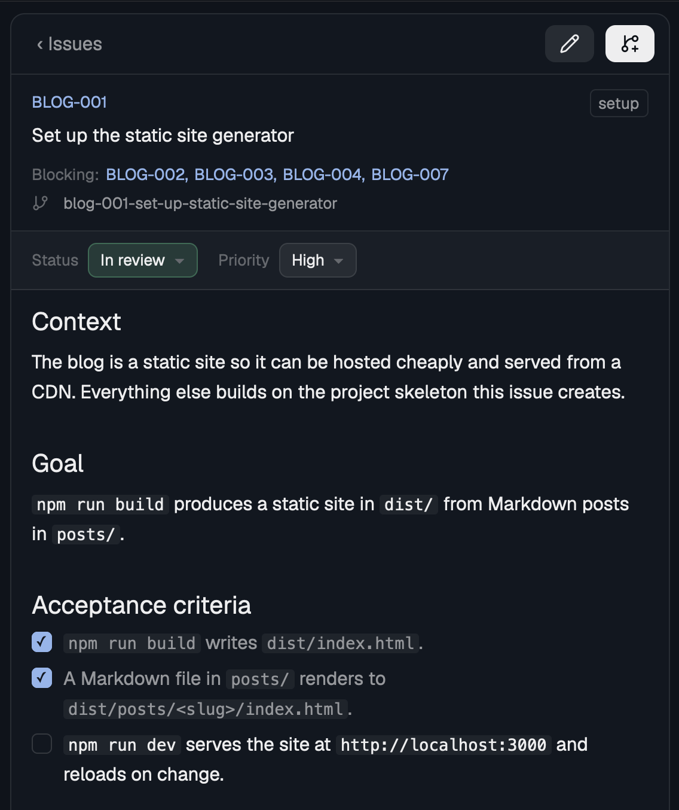
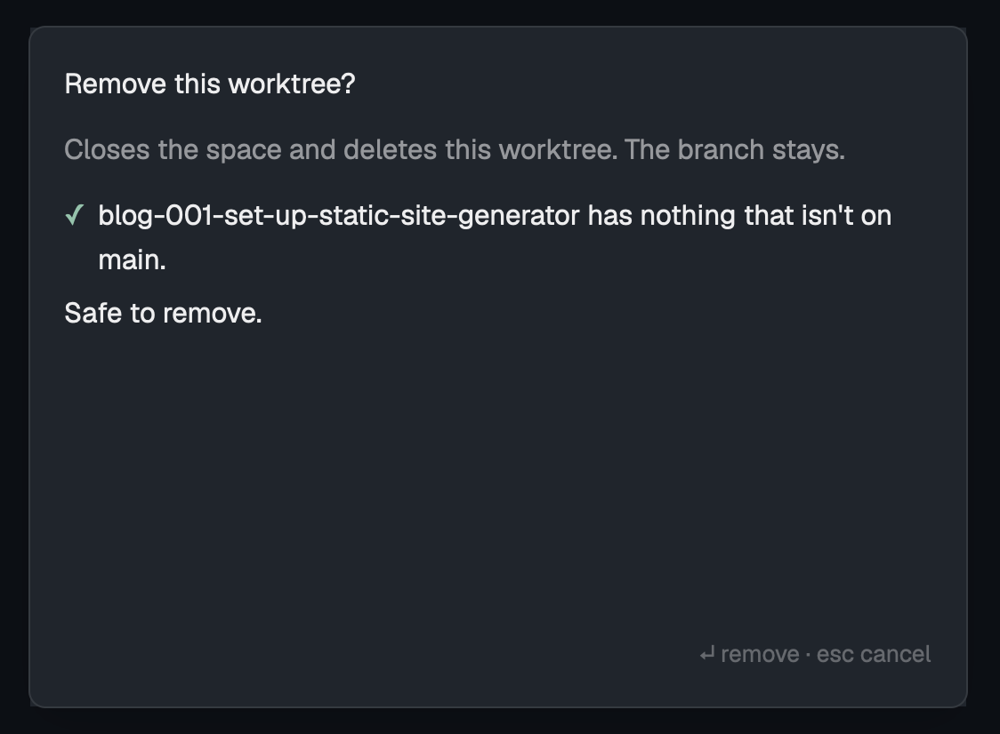

# Using the panel

**The panel** lists the issues of the repository in the focused pane. Issues can live in either of two trackers, and the panel looks the same for each:

- a Linear team, with its triage queue, projects, milestones and optional saved views;
- GitHub Issues, through the `gh` CLI.

From the panel you can:

- read an issue's status, priority, labels, assignee, delegate, pull requests and description, and edit them;
- start work on an issue in its own worktree, opened as a Herdr space with Claude working the issue;
- remove a finished worktree through a dialog that checks its branch is merged or pushed first.

The panel also tells Claude sessions in Herdr which issues it lists and which issue is open, so "the issues" and "this issue" mean what you see.

Press **Cmd-Shift-I** to show or hide the panel. It shows the issues of the repository in the focused pane, grouped by status, and refreshes when issues change.



## Scopes and labels

When a tracker has more than one list of issues, a dropdown at the top of the panel picks which one it shows. For Linear, the default is every open issue assigned to you; the team's triage queue, its other issues, its saved views and each open project (narrowed to one of its milestones if you like) are the others. The **Label** dropdown narrows the list to issues with one label.



## An issue

Click an issue to open it in place of the list. Its status and priority are dropdowns, task-list checkboxes in its description check off in place, and **Edit** turns the description into a Markdown editor. **Save** or **Cmd-S** writes it back to the tracker.



## Starting work

**Start** opens the issue's branch in a new worktree, shown as a Herdr space nested under the repository's space, with a Claude session running `/issues:work` on the issue. **Continue** reopens an issue already in progress, and **Go to space** switches to the space that already shows it. When the work is finished, the Claude session ends with a message saying the worktree can be closed.

## Removing a worktree

The mod includes a dialog that removes a worktree and closes its space. It shows whether the branch is merged or pushed, and warns about uncommitted changes before anything is lost; the branch itself is kept. Open it from a key or another mod with:

```js
openOverlay({ mod: "issues", kind: "dialog", width: 440, height: 320, props: { space: spaceId, action: "remove" } });
```


